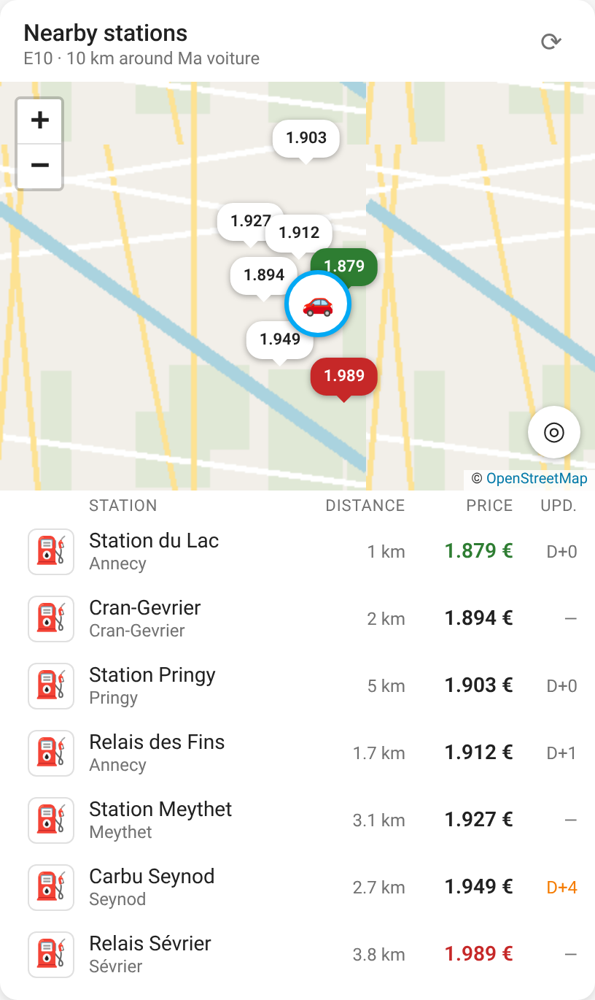
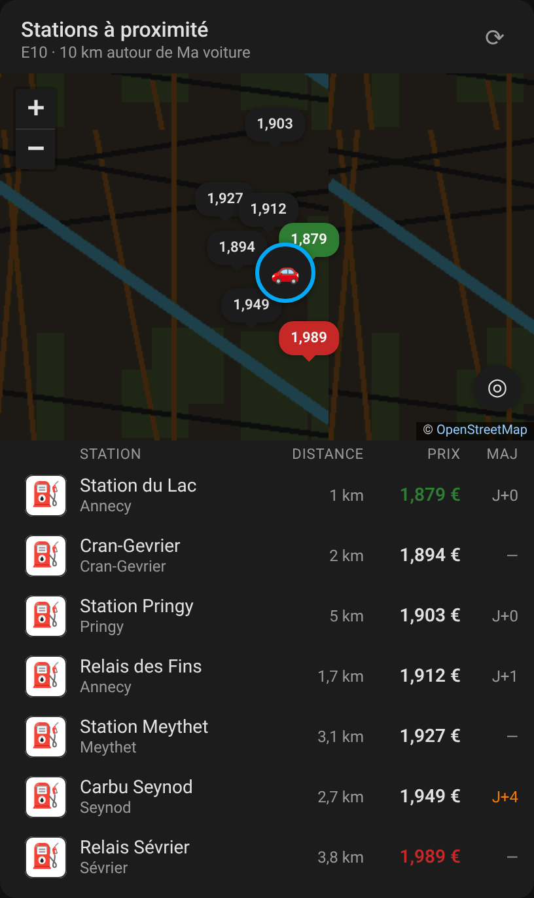

# Fuel Map Card

[🇫🇷 Version française](README.md)

A Home Assistant Lovelace card that shows **fuel stations around a vehicle** (or a person), with their prices, on a map and in a list. Data comes from the [Prix Carburant](https://github.com/Aohzan/hass-prixcarburant) integration (French fuel prices).

> Independent project, not affiliated with the Prix Carburant integration or its author.



## Features

- Automatic search for stations within an **adjustable radius** around the tracked entity (`device_tracker`, `person`).
- **Map** with a price pin per station: cheapest in green, priciest in red. The vehicle always stays on top.
- **List** sorted by price or distance: logo, name, city, distance, price and last update (D+n).
- **Click a station** in the list: the map centers on it and opens its details (address, price, directions link).
- New search once the vehicle has moved, with a minimum delay so the API is not called needlessly.
- Visual editor, light and dark themes, **French and English** interface.

| Selected station | Dark theme |
|---|---|
|  |  |

## Requirements

- Home Assistant 2024.1 or newer.
- The **Prix Carburant** integration installed and configured, in a version that provides the `prix_carburant.find_nearest_stations` action.
- An entity with a GPS position (`latitude` and `longitude` attributes).

## Installation

### With HACS / Marketplace (custom repository)

1. Open HACS (or **Settings → Marketplace** since Home Assistant 2026.11).
2. Add the custom repository `https://github.com/akoonet-homeassistant/fuel-map-card`, category **Dashboard**.
3. Install **Fuel Map Card**, then reload the browser page.

### Manual installation

1. Copy `dist/fuel-map-card.js` to `/config/www/fuel-map-card/`.
2. Add the resource: **Settings → Dashboards → ⋮ → Resources**, URL `/local/fuel-map-card/fuel-map-card.js?v=2026.11.1`, type **JavaScript module**.
3. Reload the browser page.

## Configuration

Configure the card in the visual editor ("Fuel Map Card" in the card picker) or in YAML:

```yaml
type: custom:fuel-map-card
entity: device_tracker.my_car
fuel: E10
distance: 10
```

| Option | Default | Description |
|---|---|---|
| `entity` | — | **Required.** Entity to follow (`device_tracker`, `person`). |
| `fuel` | `E10` | `E10`, `SP95`, `SP98`, `Gazole`, `E85` or `GPLc`. |
| `distance` | `10` | Search radius in km (1 to 50). |
| `max_stations` | `10` | Number of stations shown (1 to 10). |
| `sort` | `price` | List order: `price` or `distance`. |
| `show_map` | `true` | Show the map. |
| `show_list` | `true` | Show the list. |
| `map_height` | `300` | Map height in pixels. |
| `refresh_interval` | `30` | New search at least every X minutes. |
| `min_move` | `500` | New search after moving X meters. |
| `min_delay` | `2` | Minimum delay between two searches, in minutes. |
| `title` | "Nearby stations" | Card title. |
| `tile_url` | OpenStreetMap | Custom map tiles (`https://…/{z}/{x}/{y}.png` URL). |

## Good to know

- **10 stations at most**: the Prix Carburant action returns the 10 cheapest stations within the radius.
- **Last update date**: the action does not provide it. The card reads it from the Prix Carburant sensors you already have (same station, same fuel). Stations without a sensor show "—". The brand logo also comes from those sensors.
- **Distance**: straight-line distance from the entity's position, not by road.
- Searches only run while the card is on screen. The ⟳ button forces a new search.
- Map tiles come from OpenStreetMap; please follow their [usage policy](https://operations.osmfoundation.org/policies/tiles/).

## Development

```bash
npm install
npm test        # unit tests
npm run build   # builds dist/fuel-map-card.js
```

## License

MIT — see [LICENSE](LICENSE).
