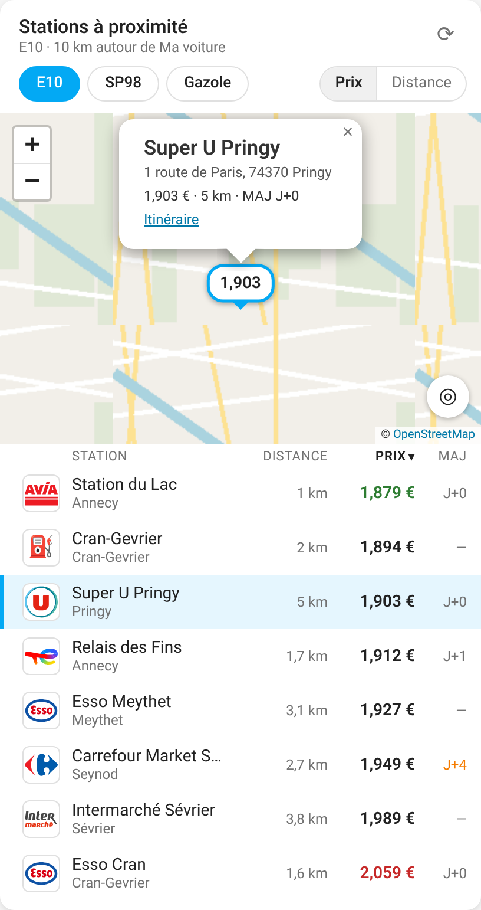
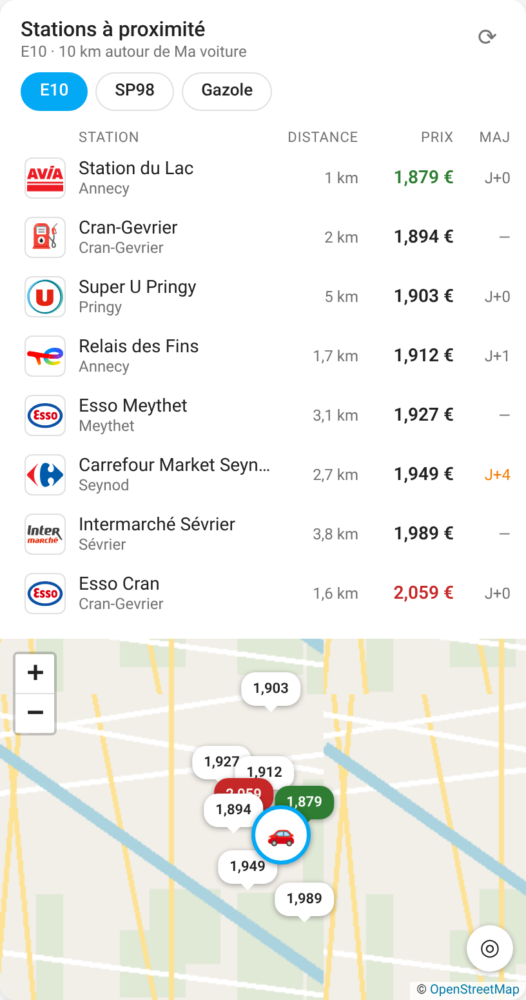

# Fuel Map Card


[🇫🇷 Version française](README.md)

[](https://github.com/akoonet-homeassistant/Fuel-Map-Card/releases)
[](LICENSE)
[](https://hacs.xyz)

A Home Assistant Lovelace card that shows **fuel stations around a vehicle** (or a person), with their prices, on a map and in a list. Data comes from the [Prix Carburant](https://github.com/Aohzan/hass-prixcarburant) integration (French fuel prices).

> Independent project, not affiliated with the Prix Carburant integration or its author.


## Features

- Automatic search for stations within an **adjustable radius** around the tracked entity (`device_tracker`, `person`).
- **Several fuels** to choose from (E10, SP95, SP98, Gazole, E85, GPLc), with tabs to switch between them.
- **Display order** of your choice: map then list, or list then map.
- **Basemap** of your choice: OpenStreetMap, OSM France, CARTO (light, dark, Voyager or automatic with the theme), terrain, satellite or a custom URL.
- **Map** with a price pin per station: cheapest in green, priciest in red. The vehicle always stays on top.
- **List** sorted by price or distance, chosen **right on the card** (Price | Distance switch or click on the column header): logo, name, city, distance, price and last update (D+n).
- **Click a station** in the list: the map centers on it and opens its details (address, price, directions link).
- New search once the vehicle has moved, with a minimum delay so the API is not called needlessly.
- Visual editor, light and dark themes, **French and English** interface.

| Selected station | List first | Dark theme |
|---|---|---|
|  |  |  |

## Requirements

- Home Assistant 2024.1 or newer.
- The **Prix Carburant** integration installed and configured, in a version that provides the `prix_carburant.find_nearest_stations` action. **Version 3.29 or later recommended**: every station in the radius, with its brand and update date.
- An entity with a GPS position (`latitude` and `longitude` attributes).

## Installation

### With HACS / Marketplace

[](https://my.home-assistant.io/redirect/hacs_repository/?owner=akoonet-homeassistant&repository=Fuel-Map-Card&category=plugin)

Or as a custom repository:

1. Open HACS (or **Settings → Marketplace** since Home Assistant 2026.11).
2. Add the custom repository `https://github.com/akoonet-homeassistant/Fuel-Map-Card`, category **Dashboard**.
3. Install **Fuel Map Card**, then reload the browser page.

### Manual installation

1. Copy `dist/fuel-map-card.js` to `/config/www/fuel-map-card/`.
2. Add the resource: **Settings → Dashboards → ⋮ → Resources**, URL `/local/fuel-map-card/fuel-map-card.js?v=2026.11.7`, type **JavaScript module**.
3. Reload the browser page.

## Configuration

Every option can be set in the visual editor ("Fuel Map Card" in the card picker), grouped in sections: Search, Header, Map, List, Refresh. In YAML:

```yaml
type: custom:fuel-map-card
entity: device_tracker.my_car
fuels:
  - E10
  - SP98
  - Gazole
distance: 10
layout: map_first
map_style: osm
```

| Option | Default | Description |
|---|---|---|
| `entity` | — | **Required.** Entity to follow (`device_tracker`, `person`). |
| `fuels` | `[E10]` | One or more fuels among `E10`, `SP95`, `SP98`, `Gazole`, `E85`, `GPLc`. With several fuels, tabs are shown. The legacy `fuel: E10` option is still accepted. |
| `distance` | `10` | Search radius in km (1 to 50). |
| `max_stations` | `10` | Number of stations shown (1 to 100). |
| `include_sensors` | `true` | Useful before Prix Carburant 3.29: adds your sensor stations within the radius, whatever their price. |
| `sort` | `price` | Default order: `price` or `distance`. The order picked on the card is remembered on the device. |
| `show_sort_toggle` | `true` | Show the Price / Distance switch on the card. |
| `layout` | `map_first` | Display order: `map_first` (map then list) or `list_first` (list then map). |
| `show_map` | `true` | Show the map. |
| `show_list` | `true` | Show the list. |
| `map_height` | `300` | Map height in pixels. |
| `refresh_interval` | `30` | New search at least every X minutes. |
| `min_move` | `500` | New search after moving X meters. |
| `min_delay` | `2` | Minimum delay between two searches, in minutes. |
| `title` | "Nearby stations" | Card title. |
| `show_header` | `true` | Show the title and subtitle. |
| `show_refresh_button` | `true` | Show the Refresh button (⟳). |
| `show_car` | `true` | Show the vehicle on the map. |
| `show_zoom_controls` | `true` | Show the zoom buttons. |
| `show_recenter_button` | `true` | Show the Recenter button. |
| `show_directions` | `true` | Directions link in a station's details. |
| `show_logo` | `true` | Brand logo in the list. |
| `show_distance` | `true` | Distance column. |
| `show_updated` | `true` | Update column. |
| `show_price_colors` | `true` | Cheapest in green, priciest in red. |
| `map_style` | `osm` | Basemap: `osm`, `osm_fr`, `auto` (CARTO light or dark with the theme), `carto_light`, `carto_dark`, `carto_voyager`, `topo`, `satellite` or `custom`. |
| `tile_url` | — | With `map_style: custom`: tile URL `https://…/{z}/{x}/{y}.png`. |
| `dark_filter` | `true` | In dark theme, darkens light basemaps. |

## Good to know

- **Stations fetched**: with Prix Carburant 3.29 or later, the card fetches every station in the radius (100 at most), with its brand and update date; the price / distance sort covers them all. With an older version, the action only returns the 10 cheapest, without date: the card then adds your Prix Carburant sensors (`include_sensors`), and the Update column shows "—" for other stations. The card detects the version automatically.
- **Logos**: they are the Prix Carburant integration's logos. The card uses the station sensor's logo when there is one, otherwise it recognizes the brand returned by the action (3.29+) or in the name (Intermarché, Carrefour, Super U, Esso, Total…, "Relais" stations being TotalEnergies). A station whose name has no brand and that has no sensor keeps the generic icon.
- **Distance**: straight-line distance from the entity's position, not by road.
- Searches only run while the card is on screen. The ⟳ button forces a new search.
- **Several fuels**: one search per fuel runs at each refresh (6 at most).
- **Basemaps**: free public services (OpenStreetMap, OSM France, CARTO, OpenTopoMap, Esri). Please follow their terms of use, e.g. the [OpenStreetMap policy](https://operations.osmfoundation.org/policies/tiles/).

## Development

```bash
npm install
npm test        # unit tests
npm run build   # builds dist/fuel-map-card.js
```

## License

MIT — see [LICENSE](LICENSE).


## Author

Developed by [@JeromeRoseau](https://github.com/JeromeRoseau) for [akoonet-homeassistant](https://github.com/akoonet-homeassistant).

