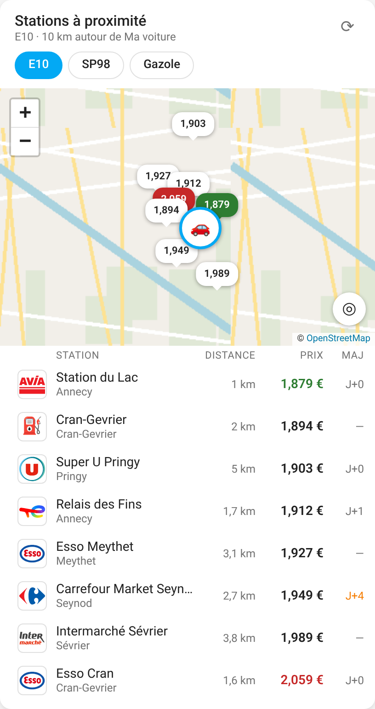
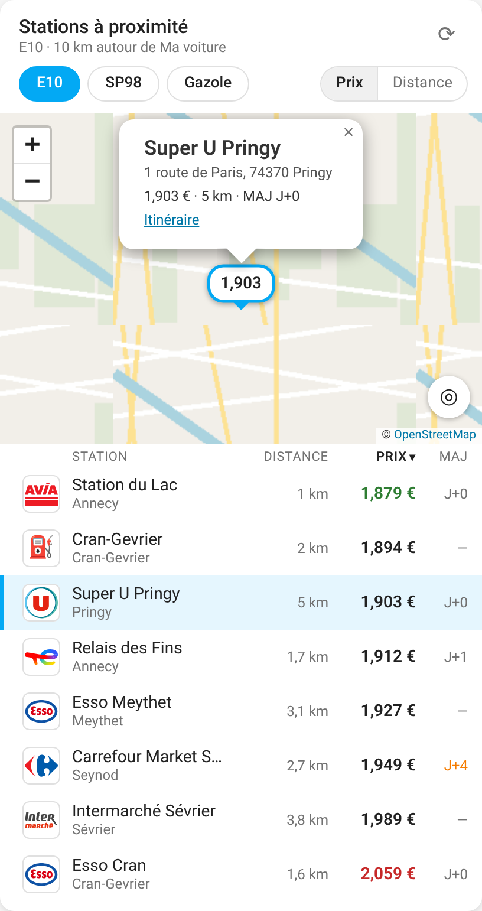
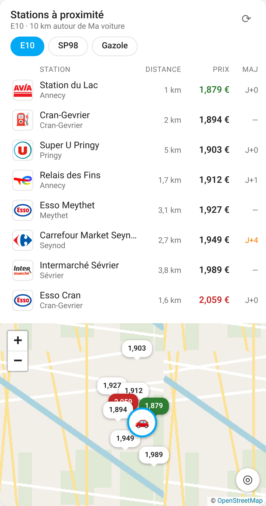
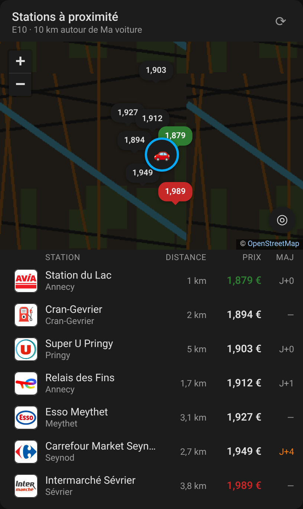

# Fuel Map Card


[🇬🇧 English version](README.en.md)

[](https://github.com/akoonet-homeassistant/Fuel-Map-Card/releases)
[](LICENSE)
[](https://hacs.xyz)

Carte Lovelace pour Home Assistant qui affiche **les stations-service autour d'un véhicule** (ou d'une personne), avec leur prix, sur une carte et dans une liste. Les données viennent de l'intégration [Prix Carburant](https://github.com/Aohzan/hass-prixcarburant).

> Projet indépendant, non affilié à l'intégration Prix Carburant ni à son auteur.



## Fonctionnalités

- Recherche automatique des stations dans un **rayon réglable** autour de l'entité suivie (`device_tracker`, `person`).
- **Plusieurs carburants** au choix (E10, SP95, SP98, Gazole, E85, GPLc), avec des onglets pour passer de l'un à l'autre.
- **Ordre d'affichage** au choix : carte puis liste, ou liste puis carte.
- **Fond de carte** au choix : OpenStreetMap, OSM France, CARTO (clair, sombre, Voyager ou automatique selon le thème), relief, satellite ou URL personnalisée.
- **Carte** avec une pastille de prix par station : la moins chère en vert, la plus chère en rouge. Le véhicule reste toujours au premier plan.
- **Liste** triée par prix ou par distance : logo, nom, ville, distance, prix et date de mise à jour (J+n).
- **Clic sur une station** dans la liste : la carte se centre dessus et ouvre sa fiche (adresse, prix, lien d'itinéraire).
- Nouvelle recherche quand le véhicule s'est déplacé, avec un délai minimum pour ne pas solliciter l'API inutilement.
- Éditeur visuel, thème clair et sombre, interface en **français et en anglais**.

| Station sélectionnée | Liste en premier | Thème sombre |
|---|---|---|
|  |  |  |

## Prérequis

- Home Assistant 2024.1 ou plus récent.
- L'intégration **Prix Carburant** installée et configurée, dans une version qui propose l'action `prix_carburant.find_nearest_stations`.
- Une entité avec une position GPS (attributs `latitude` et `longitude`).

## Installation

### Via HACS / Marketplace

[](https://my.home-assistant.io/redirect/hacs_repository/?owner=akoonet-homeassistant&repository=Fuel-Map-Card&category=plugin)

Ou en dépôt personnalisé :

1. Ouvrez HACS (ou **Paramètres → Marketplace** depuis Home Assistant 2026.11).
2. Ajoutez le dépôt personnalisé `https://github.com/akoonet-homeassistant/Fuel-Map-Card`, catégorie **Tableau de bord** (*Dashboard*).
3. Installez **Fuel Map Card**, puis rechargez la page du navigateur.

### Installation manuelle

1. Copiez `dist/fuel-map-card.js` dans `/config/www/fuel-map-card/`.
2. Ajoutez la ressource : **Paramètres → Tableaux de bord → ⋮ → Ressources**, URL `/local/fuel-map-card/fuel-map-card.js?v=2026.11.4`, type **Module JavaScript**.
3. Rechargez la page du navigateur.

## Configuration

Toutes les options se règlent dans l'éditeur visuel (« Fuel Map Card » dans la liste des cartes), regroupées en sections : Recherche, En-tête, Carte, Liste, Actualisation. En YAML :

```yaml
type: custom:fuel-map-card
entity: device_tracker.ma_voiture
fuels:
  - E10
  - SP98
  - Gazole
distance: 10
layout: map_first
map_style: osm
```

| Option | Défaut | Description |
|---|---|---|
| `entity` | — | **Obligatoire.** Entité à suivre (`device_tracker`, `person`). |
| `fuels` | `[E10]` | Un ou plusieurs carburants parmi `E10`, `SP95`, `SP98`, `Gazole`, `E85`, `GPLc`. Avec plusieurs carburants, des onglets apparaissent. L'ancienne option `fuel: E10` reste acceptée. |
| `distance` | `10` | Rayon de recherche en km (1 à 50). |
| `max_stations` | `10` | Nombre de stations affichées (1 à 10). |
| `sort` | `price` | Tri de la liste : `price` (prix) ou `distance`. |
| `layout` | `map_first` | Ordre d'affichage : `map_first` (carte puis liste) ou `list_first` (liste puis carte). |
| `show_map` | `true` | Afficher la carte. |
| `show_list` | `true` | Afficher la liste. |
| `map_height` | `300` | Hauteur de la carte en pixels. |
| `refresh_interval` | `30` | Nouvelle recherche au moins toutes les X minutes. |
| `min_move` | `500` | Nouvelle recherche après un déplacement de X mètres. |
| `min_delay` | `2` | Délai minimum entre deux recherches, en minutes. |
| `title` | « Stations à proximité » | Titre de la carte. |
| `show_header` | `true` | Afficher le titre et le sous-titre. |
| `show_refresh_button` | `true` | Afficher le bouton Actualiser (⟳). |
| `show_car` | `true` | Afficher le véhicule sur la carte. |
| `show_zoom_controls` | `true` | Afficher les boutons de zoom. |
| `show_recenter_button` | `true` | Afficher le bouton Recentrer. |
| `show_directions` | `true` | Lien Itinéraire dans la fiche d'une station. |
| `show_logo` | `true` | Logo de l'enseigne dans la liste. |
| `show_distance` | `true` | Colonne Distance. |
| `show_updated` | `true` | Colonne MAJ (date de mise à jour). |
| `show_price_colors` | `true` | Moins chère en vert, plus chère en rouge. |
| `map_style` | `osm` | Fond de carte : `osm`, `osm_fr`, `auto` (CARTO clair ou sombre selon le thème), `carto_light`, `carto_dark`, `carto_voyager`, `topo`, `satellite` ou `custom`. |
| `tile_url` | — | Avec `map_style: custom` : URL des tuiles `https://…/{z}/{x}/{y}.png`. |
| `dark_filter` | `true` | En thème sombre, assombrit les fonds de carte clairs. |

## Bon à savoir

- **10 stations au maximum** : l'action Prix Carburant renvoie les 10 stations les moins chères du rayon.
- **Date de mise à jour** : l'action ne la fournit pas. La carte la reprend des capteurs Prix Carburant déjà configurés (même station, même carburant). Pour une station sans capteur, la colonne affiche « — ».
- **Logos** : ce sont ceux de l'intégration Prix Carburant. La carte prend le logo du capteur de la station s'il existe, sinon elle reconnaît l'enseigne dans le nom (Intermarché, Carrefour, Super U, Esso, Total…, les « Relais » étant des TotalEnergies). Une station dont le nom ne contient pas l'enseigne et qui n'a pas de capteur garde l'icône générique.
- **Distance** : calculée à vol d'oiseau depuis la position de l'entité, pas par la route.
- La recherche n'a lieu que lorsque la carte est affichée à l'écran. Le bouton ⟳ force une nouvelle recherche.
- **Plusieurs carburants** : une recherche par carburant est lancée à chaque actualisation (6 au maximum).
- **Fonds de carte** : services publics gratuits (OpenStreetMap, OSM France, CARTO, OpenTopoMap, Esri). Merci de respecter leurs conditions d'utilisation, par exemple la [politique d'OpenStreetMap](https://operations.osmfoundation.org/policies/tiles/).

## Développement

```bash
npm install
npm test        # tests unitaires
npm run build   # génère dist/fuel-map-card.js
```

## Licence

MIT — voir [LICENSE](LICENSE).


## Auteur

Développé par [@JeromeRoseau](https://github.com/JeromeRoseau) pour [akoonet-homeassistant](https://github.com/akoonet-homeassistant).

